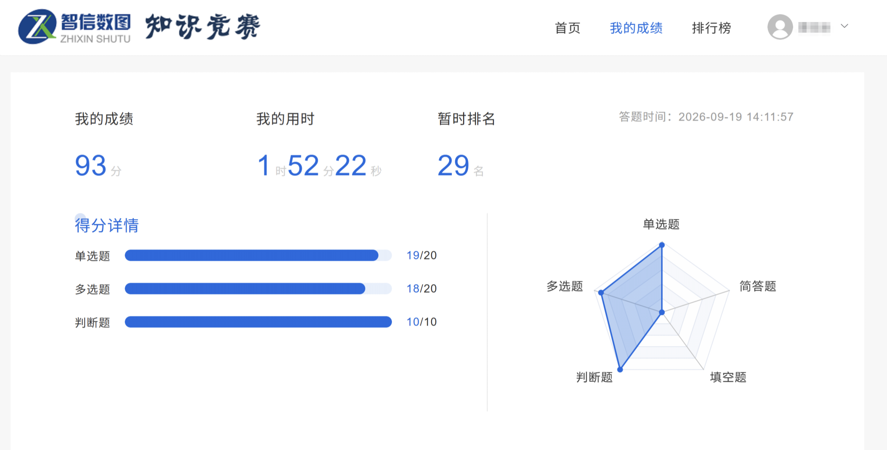

# AI+ 信息素养大赛答题技能



> **真实初赛 agent 全自动完成**
> 93 分 · 用时 1 小时 52 分 22 秒 · 单选 19/20 · 多选 18/20 · 判断 10/10

一套面向 **AI+信息素养大赛** 的本地答题系统：把「必须去官网实测」的检索题，做成可复现、可核验、可交接的流水线。

不是题库搬运，也不靠背答案。它沉淀的是**方法与坑**：

- 答案写实测值（`1439`），不写选项字母（`A`）
- 同一平台换个匹配方式，结果可能差一倍
- 无法核验时明确写「卡在哪一步」，绝不把推断伪装成实测

---

## 快速开始

把 `SKILL.md` 交给 Claude Code：

```bash
cp -r . ~/.claude/skills/ai-information-literacy-skill
```

无头检索：

```bash
pip install websocket-client
python scripts/headless_chrome.py --url "https://www.cqvip.com/advancesearch"
python scripts/headless_chrome.py --url URL --js "document.title"
python scripts/headless_chrome.py --url URL --focus "#kw" --type "关键词" --enter
```

---

## 系统结构

```
.
├── SKILL.md                      Claude Code 技能本体（流程 / 格式 / 陷阱）
├── references/platforms.md       11 个平台的入口、字段、匹配语义
├── scripts/headless_chrome.py    无头 Chrome（CDP）
└── engine/                       完整本地系统
    ├── scripts/   71 个脚本      匹配 / 路由 / 变体 / 评测 / 预检 / 生成
    ├── config/    26 个配置      平台注册表、URL 配方、检索模板、边界策略
    ├── skill/                    校赛期的 16 份技能文档
    ├── handoff/                  省赛交接包（方法论 + 题库）
    ├── db/                       SQLite 题库
    ├── tests/                    路由、变体隔离、输出合规等测试
    └── data/exports/             题库导出（CSV / JSONL）
```

### 运行时分层

```
题目
 ├─ L0 精确命中（题干 + 选项签名）
 ├─ L1 标准化题干
 ├─ L2 相似题干（difflib ≥ 0.88）
 ├─ L3 选项内容集合
 ├─ 同型题匹配 → 只复用「配方」，答案强制为空
 └─ 平台配方 → 官方站点实测 → 人工交接
```

### 资产清单

| 资产 | 规模 | 位置 |
|---|---|---|
| 题库（SQLite） | **248** 题 | `engine/db/question_bank.sqlite` |
| 题库（三段式整理） | **290** 题 | `engine/handoff/question_bank.md` |
| 网址参考 | **407** 个（去重分类） | 同上 |
| 平台注册表 | **125** 个平台 | `engine/config/platform_registry.json` |
| URL 配方 | **336** 条 | `engine/config/official_urls.json` |
| 检索式模板 | 10 套 | `engine/config/query_templates.json` |
| 题型模板 | A–N 14 类 | `engine/skill/answer_patterns.md` |

---

## 方法论

**1. 实测值优先。** 题目给的是 A/B/C/D，真正有用的是页面上的那个数字。答案首行放实测值，下面附可复现的来源路径。

**2. 匹配方式是最大的坑。** 维普「精确」= 不分词、允许前后加内容（等价于"包含"）；「模糊」= 分词 + 位置调换，结果常翻倍。四个选项都对不上时，先怀疑检索条件。

**3. 筛选要能自证。** 勾选后把分面各项数字相加：总和 = 结果总数 → 筛选没生效；明显小于总数 → 生效了。

**4. 不猜，也不绕。** 验证码、滑块、登录墙、Cloudflare → 停止自动化，转人工，不绕过。

---

## 无头浏览器

- `--headless=new`，不弹窗
- 独立临时 profile，不读取、不修改日常浏览器数据
- 自动把 UA 中的 `HeadlessChrome` 换成同版本 `Chrome`（部分站点否则直接 412）
- 本地 CDP 流量强制 no-proxy（避免系统代理把 `127.0.0.1:9333` 转发出错）

---

## 边界

- 只用于**公开页面**的检索与核对。
- 遇到验证码 / 滑块 / 登录墙：转人工，不绕过。
- 站点条款与赛事规则优先于本仓库；请遵守所在赛事的合规要求。
- 题目正确性以官方公布为准，本仓库只保证「检索过程可复现、来源可回溯」。
- `engine/` 中的题库与配置用于研究复盘，不构成对任何赛事规则的豁免。

## License

MIT
